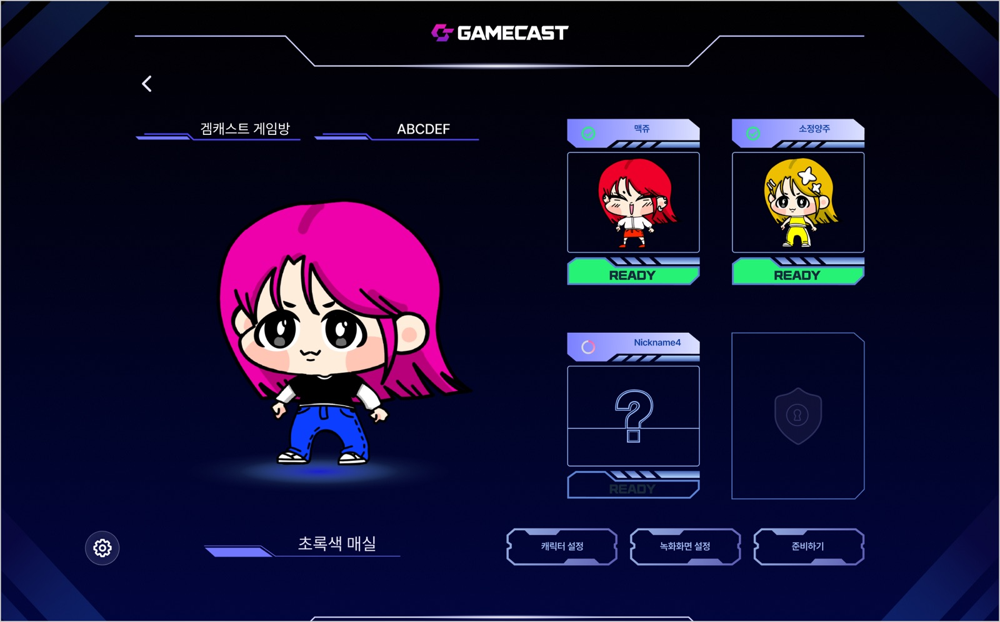

<h1>KIHYEON KIM</h1>

<b>Student</b>

  <a href="https://github.com/zzl-hyun">GitHub</a> ·
  <a href="mailto:kimgihyun877@gmail.com">Email</a>

## CO-Work Projects

### Paper Summarizer

> An LLM-powered platform for summarizing and visualizing academic papers

Built a parsing model server within a backend-worker architecture that separates document processing from AI summarization. Designed inter-service workflows and implemented callback integrations and summarization workers powered by Gemini and OpenAI.

`Spring Boot` `Java` `Python` `AI Pipeline` `Google Gen AI SDK` `Docker` `AWS`

[Backend](https://github.com/joomidang/paper-summarizer-backend) · [Summary Worker](https://github.com/joomidang/paper-summarizer-summry-worker) · [Presentation](https://foil-tiglon-4b0.notion.site/LLM-3a8e7043597980a88854ddd802966579)

---

### GMG · 가면가

> A scheduling platform that reduces coordination overhead using participants' availability preferences

Developed 30-minute availability heatmaps and location recommendations, with real-time updates delivered via SSE after transaction commits. Improved participant schedule management, prevented race conditions during concurrent joins, and strengthened heatmap aggregation consistency.

`Java 21` `Spring Boot 3.5` `JPA` `Flyway` `MySQL` `SSE` `Docker` `AWS`

[GMG](https://github.com/project-GMG/)

  
  &nbsp;
  

---

### GameCast

> A short-form content creation tool that records multiplayer sessions and generates AI-powered highlights

Built a recording workflow that captures each participant's screen, game audio, and microphone separately, then extracts audio to detect highlight moments. The platform generates three highlight clips and provides a layer-based editor for combining clips and media elements into short-form videos. Implemented room, video, and WebRTC services, integrated AI highlight callbacks, and established an S3-based media pipeline with Docker and AWS CI/CD.

`TypeScript` `Express` `WebRTC` `Socket.IO` `Docker` `AWS` `YAMNet`

[Server](https://github.com/UMC-GameCast/gamecast-server)

  
  &nbsp;
  

### Independent Projects

| Project | Description | Technology |
|---|---|---|
| [Automatic Settlement](https://github.com/zzl-hyun/Automatic-settlement) | Calculates individual shares and final transfers for group expenses | `Vanilla JS` `localStorage` |
| [Taskbar Music Widget](https://github.com/zzl-hyun/TaskbarMusicWidget) | Controls playback information and per-app volume from the Windows taskbar | `.NET 8` `WPF` `NAudio` |
| [Taskbar Speed Control](https://github.com/zzl-hyun/TaskbarSpeedControl) | Customizes the animation speed and frame rate of Windows taskbar auto-hide | `C#` `C++` `WinAPI` |
| [macOS Preview Image Paste](https://github.com/zzl-hyun/MacOS-preview-image-paste) | Converts PNG data into Preview-compatible objects for pasting images into PDFs | `Swift` `Shell` `AnnotationKit` |
| idontknowseourl | - | - |
| Stack Overflow | - | - |

### Contribution Calendar

  <picture>
    <source media="(prefers-color-scheme: dark)" srcset="https://raw.githubusercontent.com/zzl-hyun/zzl-hyun/output-3d-contrib/night.svg" />
    <source media="(prefers-color-scheme: light)" srcset="https://raw.githubusercontent.com/zzl-hyun/zzl-hyun/output-3d-contrib/day.svg" />
    
  </picture>

## Education

### Jeonbuk National University

- B.S. in Computer Science and Engineering
- Microdegree in Big Data Software Engineering
- GPA `4.10 / 4.50`

## Activities

### [SK AI Leader Academy (SKALA) Trainee](https://2026skala.co.kr/)

- SK AX · Jul 2026 – Present

- Selected as a trainee for the 4th cohort of SK AI Leader Academy (SKALA), an enterprise-focused AI and software engineering program.
- Completed intensive hands-on training across AI, backend, cloud, DevOps, databases, and full-stack web development.

- Built AI applications using Python, Java/Spring Boot, Vue.js, PostgreSQL, Docker, Kubernetes, and cloud-native development practices.

- Developed and deployed LLM-based systems covering Transformer architectures, Spring AI, LangChain, RAG pipelines, Vector Databases, AI Agents, model serving, and AIOps.

- Applied Agile methodologies, MSA architecture, DevOps workflows, and software engineering best practices through enterprise-scale team projects and capstone development.

### [Purdue Academy of Global Engineering (PAGE)](https://engineering.purdue.edu/GEP/Global-Opportunities/PAGE)

- [Purdue University](https://www.purdue.edu/) · West Lafayette, Indiana · Jun 2025 – Jul 2025
- Selected for the Big Data Innovation Convergence University projects overseas research program and participated in a 4-week training and research program focusing on Machine Learning and Optimization at Purdue University, USA.
- In the Machine Learning course, learned the principles and applications of various algorithms—including Regression, KNN, Decision Trees, SVM, and Neural Networks—using Python.
- In the Optimization course, studied metaheuristic and optimization algorithms such as Simulated Annealing, Tabu Search, Genetic Algorithms, Particle Swarm Optimization, and Ant Colony Optimization.
- Gained hands-on experience in analyzing datasets and applying algorithms to real-world problems through a team project in the fields of machine learning and optimization.

### [University MakeUs Challenge (UMC)](https://umc.makeus.in/)

- University MakeUs Challenge (UMC) · Mar 2025 – Aug 2025
- Participated as a Node.js backend developer in the 8th cohort of UMC (University MakeUs Challenge), completing backend development training and team projects.
- Learned Node.js-based RESTful API design and implementation, database integration, and collaborative development using Git/GitHub.
- In the team project GameCast, took charge of API server development and voice analysis server integration, while establishing a service deployment environment using Docker, AWS EC2, and AWS ECR.
- Automated build and deployment processes by configuring a GitHub Actions-based CI/CD pipeline, collaborating closely with PMs, designers, and frontend developers through the full lifecycle from service development to final release.

## Awards

### [산학협력 SW캡스톤디자인 경진대회 최우수상](https://swuniv.jbnu.ac.kr/festival/jbnusw?gc=893BAOF&do=view&festival_id=gvyje9Tei6W679047c5&syear=2025&content_id=bzCg8OImfwl6886e13f)

**Organizer** · Jeonbuk National University SW-Centered University Project Group
**Awarded** · Jun 20, 2025
**Project** · AI-powered academic paper summarization and visualization platform using LLMs
**Repository** · [Paper Summarizer](https://github.com/joomidang/paper-summarizer-backend)

## Certifications

| Certification | Detail | Date |
|---|---:|---:|
| 정보처리기사 | 국가기술자격 | 2025.12 |
| 빅데이터분석기사 | 국가기술자격 | 2025.12 |
| TOEIC Speaking | 140 | 2025.02 |
| TOEIC | 850 | 2023.08 |
